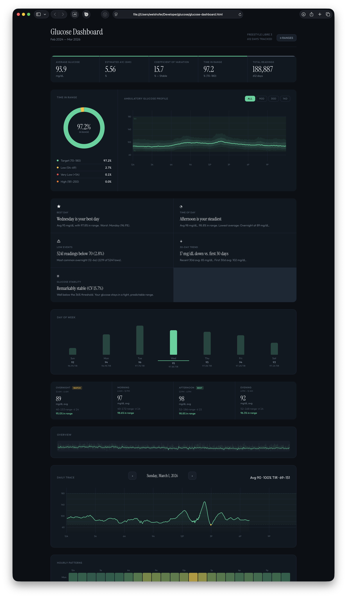

# Glucose Dashboard

A beautiful, interactive visualization tool for continuous glucose monitor (CGM) data from FreeStyle Libre and Dexcom devices. Single HTML file — no installation, no server, no data uploaded anywhere.

## Features

- **Key Metrics** — Average glucose, estimated A1C (GMI), coefficient of variation, time in range, and total readings at a glance
- **Time in Range Donut** — Animated breakdown of time spent in each glucose zone
- **Ambulatory Glucose Profile (AGP)** — The gold standard 24-hour overlay showing median, IQR, and 10th–90th percentile bands
- **Auto-Generated Insights** — Best/worst day of week, time-of-day patterns, low event analysis, trend direction, dawn effect detection, and stability assessment
- **Day of Week Analysis** — Bar chart comparing average glucose and time in range across days
- **Time of Day Breakdown** — Overnight, morning, afternoon, and evening stats with best/watch badges
- **Overview Timeline** — Full date range sparkline with daily min/max bands — click any day to navigate
- **Daily Trace** — Full-resolution 5-minute data for any single day with arrow key navigation
- **Hourly Heatmap** — Day-of-week × hour-of-day pattern visualization
- **Custom Ranges** — Adjustable low, high, very-low, and very-high thresholds (standard defaults: 54/70/180/250)
- **Period Filtering** — All data, 90-day, 30-day, or 14-day views that update every component

## Quick Start

1. **Download** `glucose-dashboard.html` (that's the entire app — one file)
2. **Open** it in any modern browser (Chrome, Firefox, Safari, Edge)
3. **Export** your data from [LibreView](https://www.libreview.com) or [Dexcom Clarity](https://clarity.dexcom.com) as CSV
4. **Drop** the CSV file onto the dashboard

That's it. No install. No account. No internet required (fonts fall back gracefully offline).

## How to Export Your Data

### From LibreView (web)
1. Log in to [libreview.com](https://www.libreview.com)
2. Go to **Reports** or your profile menu
3. Click **Download Glucose Data** or **Export**
4. Save the CSV file

### From FreeStyle Libre App
The app itself doesn't export CSV directly — use LibreView (it syncs automatically if connected).

### From Dexcom Clarity (web)
1. Log in to [clarity.dexcom.com](https://clarity.dexcom.com)
2. Go to any **Reports** page
3. Click the **Export** icon (top right)
4. Select your date range and download the CSV file

## Privacy

**Your data never leaves your computer.** The dashboard is a static HTML file that processes everything in your browser using JavaScript. There is no server, no analytics, no tracking, no cookies. The only network requests are loading two Google Fonts (Instrument Serif and Outfit), which fall back to system fonts if blocked.

## Compatibility

| CGM Device | Supported |
|---|---|
| FreeStyle Libre 3 | Yes (via LibreView CSV) |
| FreeStyle Libre 2 | Yes (via LibreView CSV) |
| FreeStyle Libre 14 Day | Yes (via LibreView CSV) |
| Dexcom G6 / G7 | Yes (via Clarity CSV) |
| Medtronic, etc. | Not yet — PRs welcome |

## Browser Support

Any modern browser with ES5+ and Canvas support. Tested on:
- Chrome 90+
- Firefox 90+
- Safari 15+
- Edge 90+

## Keyboard Shortcuts

| Key | Action |
|---|---|
| `←` Left Arrow | Previous day in Daily Trace |
| `→` Right Arrow | Next day in Daily Trace |

## Understanding the Metrics

| Metric | What It Means |
|---|---|
| **Average Glucose** | Mean of all readings in the selected period |
| **GMI (Glucose Management Indicator)** | Estimated A1C calculated from CGM data: `3.31 + 0.02392 × avg` |
| **CV (Coefficient of Variation)** | Standard deviation ÷ mean × 100. Below 36% is considered stable |
| **Time in Range** | Percentage of readings between your low and high thresholds |

## Customization

Click the **Ranges** button in the header to adjust:
- **Very Low** threshold (default: 54 mg/dL)
- **Low** threshold (default: 70 mg/dL)
- **High** threshold (default: 180 mg/dL)
- **Very High** threshold (default: 250 mg/dL)

All charts, stats, and insights recalculate immediately when you apply new ranges.

## Contributing

PRs welcome. Some ideas:
- Support for Medtronic CareLink CSV format
- Data export / PDF report generation
- Meal / insulin event overlay on daily trace
- Multi-period comparison view
- mmol/L unit support

## License

MIT

---

Built with vanilla HTML, CSS, and JavaScript. No frameworks. No build tools. No dependencies.
